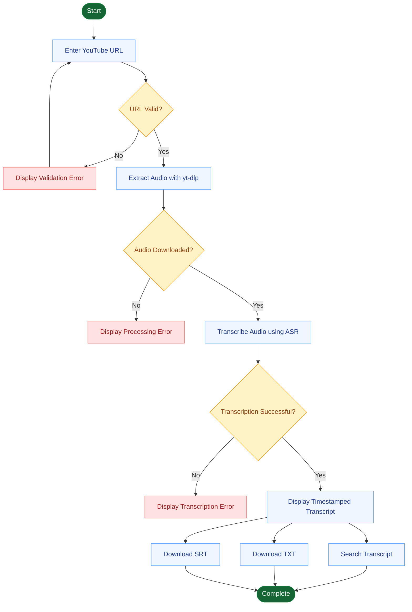

# YouTube ASR System

**Convert YouTube videos into searchable, downloadable text transcripts.**

YouTube ASR System is a Python-based web application built with Streamlit that extracts audio from YouTube videos and converts speech into text. It provides a simple interface for processing videos and viewing, searching, and exporting transcript segments.

---

## Overview

The YouTube ASR System streamlines the process of turning spoken content from YouTube videos into text. It combines audio downloading, speech recognition, and transcript presentation in a user-friendly web interface.

The project is designed to make video transcription accessible without requiring users to interact directly with command-line transcription tools.

## Features

- **YouTube Audio Extraction** — Extract audio from supported YouTube video URLs using `yt-dlp`.
- **Automatic Speech Recognition** — Convert extracted audio into text using the project's transcription module.
- **Interactive Web Interface** — Process videos and review transcripts through a Streamlit application.
- **Timestamped Transcripts** — Display transcript segments with start and end times when provided by the transcription engine.
- **Transcript Search** — Search transcript text to locate relevant content.
- **Multiple Export Formats** — Download transcripts in plain-text (`.txt`) and SubRip Subtitle (`.srt`) formats.
- **Modular Python Architecture** — Keep downloading, audio processing, and transcription functionality organized in separate modules.

## Technology Stack

| Technology | Purpose |
|---|---|
| Python | Core application logic |
| Streamlit | Interactive web interface |
| yt-dlp | YouTube media extraction |
| FFmpeg | Audio processing support |
| Automatic Speech Recognition (ASR) | Speech-to-text transcription |

## Project Structure

```text
youtube-asr-system/
├── app.py                 # Streamlit application
├── src/
│   ├── downloader.py      # YouTube audio downloading
│   ├── chunker.py         # Audio segmentation utilities
│   └── transcriber.py     # Speech-to-text processing
├── audio/                 # Downloaded audio files
├── chunks/                # Audio segments, if generated
├── transcripts/           # Saved transcript files
├── requirements.txt       # Python dependencies
├── .gitignore             # Git exclusion rules
└── README.md              # Project documentation
```

*Note: The directories shown for generated files may be created at runtime. The exact structure depends on the current implementation.*

## Getting Started

Follow these steps to run the application locally.

### Prerequisites

Before you begin, ensure you have:

- Python installed on your system. Python 3.11 or later is recommended.
- Git installed.
- FFmpeg installed and available on your system `PATH`.
- A supported speech recognition backend and any required model dependencies configured in the transcription module.

### 1. Clone the Repository

```bash
git clone https://github.com/Darsana0204/youtube-asr-system.git
cd youtube-asr-system
```

### 2. Create a Virtual Environment

**Windows PowerShell**

```powershell
python -m venv venv
.\venv\Scripts\Activate.ps1
```

**macOS / Linux**

```bash
python3 -m venv venv
source venv/bin/activate
```

### 3. Install Dependencies

```bash
python -m pip install --upgrade pip
pip install -r requirements.txt
```

Make sure `requirements.txt` includes all the Python packages required by the application.

### 4. Install and Verify FFmpeg

Install FFmpeg using the installation method appropriate for your operating system. Ensure its executable is available through `PATH`.

Verify the installation:

```bash
ffmpeg -version
```

If the command is not recognized, add the FFmpeg executable directory to your system `PATH`, then reopen your terminal.

### 5. Run the Application

From the project root directory, execute:

```bash
streamlit run app.py
```

Streamlit will provide a local URL, typically:

```text
http://localhost:8501
```

Open that URL in your browser to use the application.

## How to Use

1. Launch the Streamlit application.
2. Enter a valid YouTube video URL.
3. Start the audio extraction and transcription process.
4. Wait for the transcription to finish.
5. Review the generated transcript and its timestamps.
6. Use the search functionality to find specific words or passages.
7. Download the transcript in `.txt` or `.srt` format, as supported by the application.

Processing time depends on the video's duration, audio quality, and the speech recognition backend being used.

## Configuration and Dependencies

The main application components are organized as follows:

- **`app.py`** — Manages the user interface and transcription workflow.
- **`src/downloader.py`** — Handles audio extraction from YouTube URLs.
- **`src/chunker.py`** — Provides audio segmentation functionality where used by the workflow.
- **`src/transcriber.py`** — Performs speech recognition and returns transcript data.

Review these modules when configuring the transcription backend, audio-processing behavior, or output format.


## System Workflow




## Troubleshooting

**The application does not start**

- Confirm that the virtual environment is activated.
- Install dependencies from `requirements.txt`.
- Run the application from the repository root.

**FFmpeg is not detected**

- Verify the installation with `ffmpeg -version`.
- Ensure FFmpeg is available through your system `PATH`.

**YouTube audio extraction fails**

- Check that the URL is valid and the video is accessible.
- Update `yt-dlp` if needed:

  ```bash
  python -m pip install --upgrade yt-dlp
  ```

- YouTube may change its extraction requirements, so consult the `yt-dlp` documentation if the problem persists.

**Transcription fails**

- Check the error message from the transcription module.
- Verify that the configured ASR backend and its dependencies are installed.
- Confirm that the downloaded audio file is accessible and supported.

## Responsible Use

Use this application only with content you are authorized to access and process. Respect copyright, privacy, platform terms, and applicable laws. Do not use the application to redistribute copyrighted material or process recordings without appropriate permission.

## Future Improvements

Potential areas for further development include:

- Support for additional transcription engines.
- Improved handling of long audio files through chunked processing.
- Language selection and multilingual transcription.
- Transcript editing and enhanced search.
- Additional export formats.
- Deployment as a publicly accessible web application.

## Contributing

Contributions, suggestions, and bug reports are welcome.

1. Fork the repository.
2. Create a feature branch.
3. Make and test your changes.
4. Submit a pull request describing your changes.

Please keep changes focused, document new configuration requirements, and avoid committing virtual environments, generated audio, private credentials, or other sensitive files.

## License

No license has been specified in this README. If you intend to distribute or open-source the project, add an appropriate `LICENSE` file and update this section.

---

**Developed by [Darsana](https://github.com/Darsana0204)**

[View the repository on GitHub](https://github.com/Darsana0204/youtube-asr-system)

